# PcLigApp: PcLiga en el móvil (Android, no oficial)

PcLiga, el manager de fútbol online, adaptado al teléfono. Es la misma
PcLiga de siempre, con tu cuenta y tus datos, pero cada pantalla se acomoda
al móvil: sin pellizcar, ampliar y deslizar para encontrar un dato.

> **App no oficial.** Hecha por un manager para los managers. No tiene
> relación con los responsables de PcLiga.

## Qué cambia respecto de la web

### Menús

La barra de accesos de PcLiga (alineación, plantilla, tácticas,
calendario…) queda fija arriba y se desliza de costado; la flecha de su
izquierda vuelve a la página anterior. El menú izquierdo
de la web pasa al botón ☰, con todas las secciones del juego; la columna
derecha, al botón ⋮, con lo que se puede hacer en la página que estás
viendo: en la ficha de otro equipo, por ejemplo, mandarle un comunicado,
ofrecerle un contrato o una transferencia, añadirlo a tu cartera o ver su
táctica. Arriba de todo, en cualquier página, **Copiar enlace de esta
página** copia su dirección en pcliga.com para pasársela a otro manager.

<table align="center"><tr>
<td align="center" valign="top" width="140">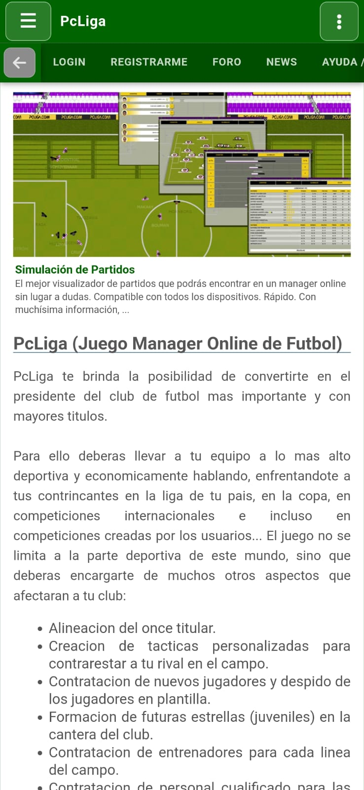<br><sub>Portada, antes de iniciar sesión</sub></td>
<td align="center" valign="top" width="140">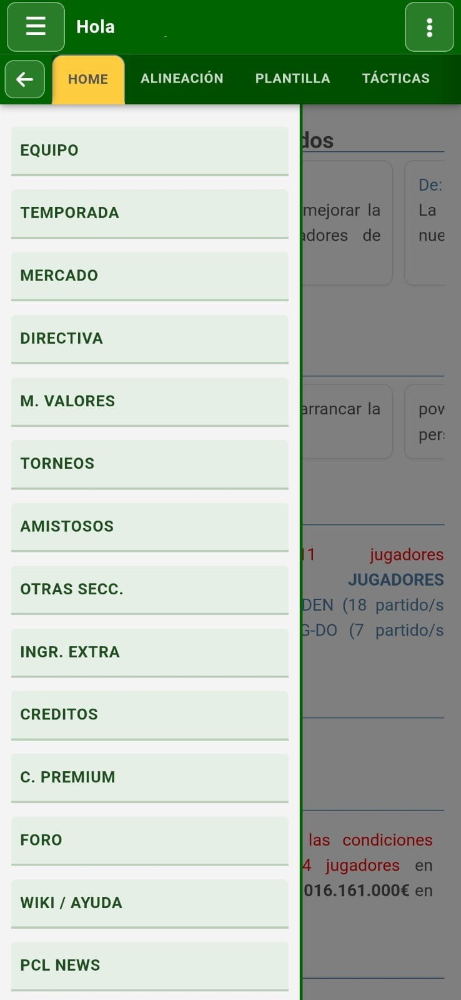<br><sub>Menú ☰: todas las secciones del juego</sub></td>
</tr></table>
<table align="center"><tr>
<td align="center" valign="top" width="140">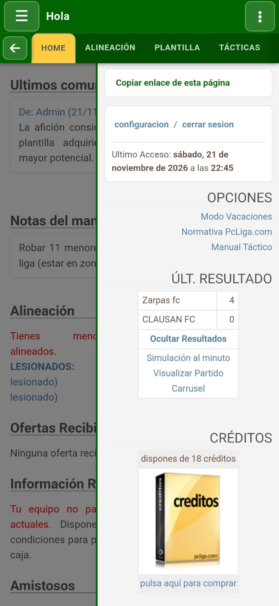<br><sub>Menú ⋮: copiar el enlace, arriba de todo</sub></td>
<td align="center" valign="top" width="140">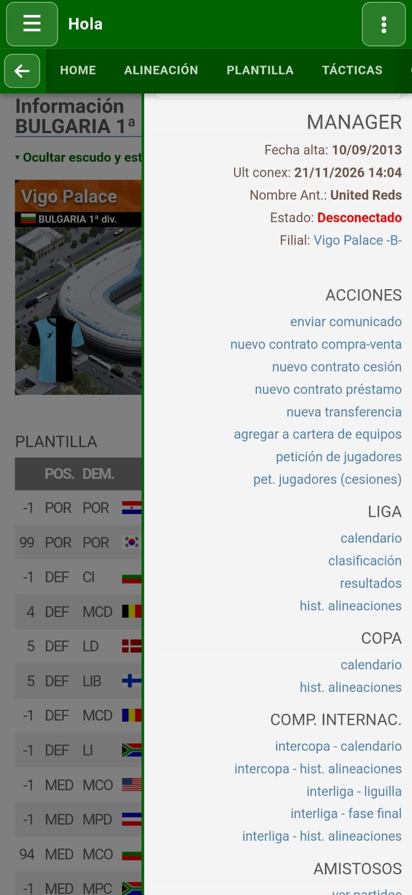<br><sub>Menú ⋮ en otro equipo: sus datos y acciones</sub></td>
</tr></table>

### Alineación, tácticas y clasificación

Las tablas se acomodan al ancho de la pantalla. Cuando una tabla de
jugadores es más ancha que la pantalla —por ejemplo, con el móvil en
vertical—, se desliza de costado y la demarcación y el nombre quedan fijos
a la izquierda, para saber siempre de quién es cada fila. En la alineación
y en la ficha de otro equipo, debajo de las tablas, **Vista de tabla**
elige entre la completa, con todas las stats, y la resumida, que las quita
para que la tabla quepa en la pantalla. El ojo de cada jugador abre su
resumen, con las stats con decimales y las medias: en la plantilla está
siempre, y en las demás tablas, en la vista resumida. La clasificación
también se ve completa y, debajo, se puede pasar a la resumida, con los
puntos y los criterios de desempate. En tácticas, el campo entra entero en
la pantalla. Y con el teléfono girado, muchas tablas se ven enteras.

<table align="center"><tr>
<td align="center" valign="top" width="140">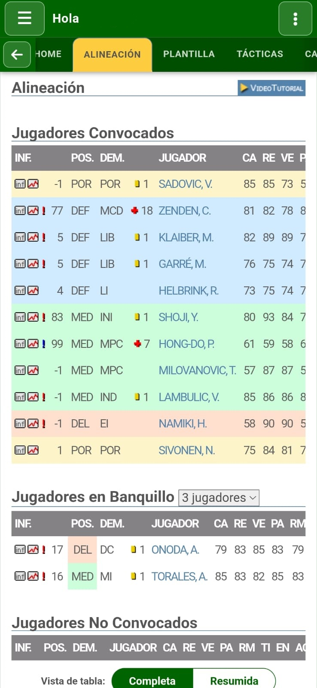<br><sub>Alineación completa: todas las stats</sub></td>
<td align="center" valign="top" width="140">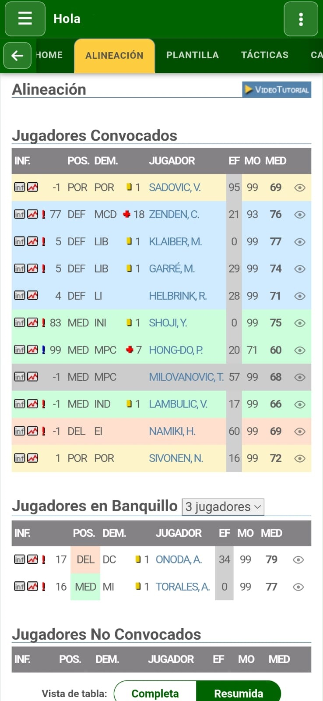<br><sub>Alineación resumida: las stats, en el ojo</sub></td>
</tr></table>
<table align="center"><tr>
<td align="center" valign="top" width="140">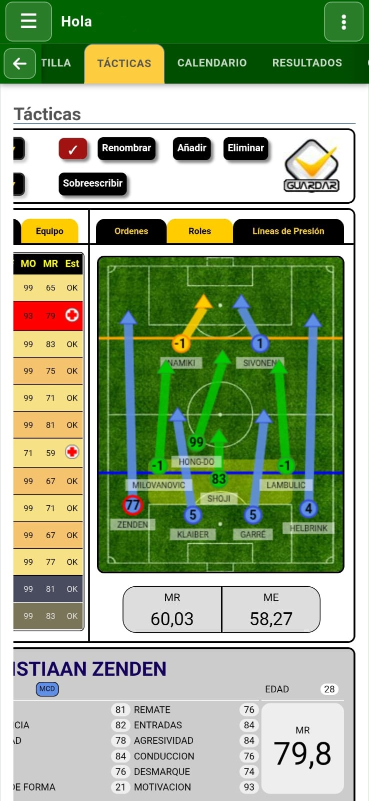<br><sub>Tácticas: el campo entra entero</sub></td>
</tr></table>
<table align="center"><tr>
<td align="center" valign="top" width="140">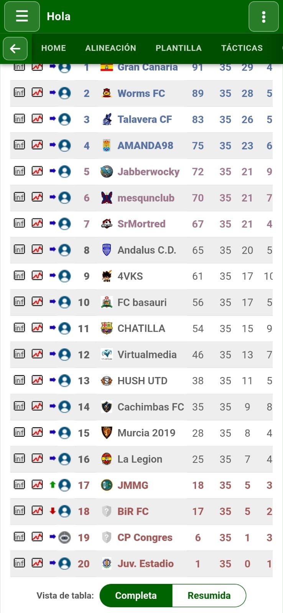<br><sub>Clasificación completa: todas las columnas</sub></td>
<td align="center" valign="top" width="140">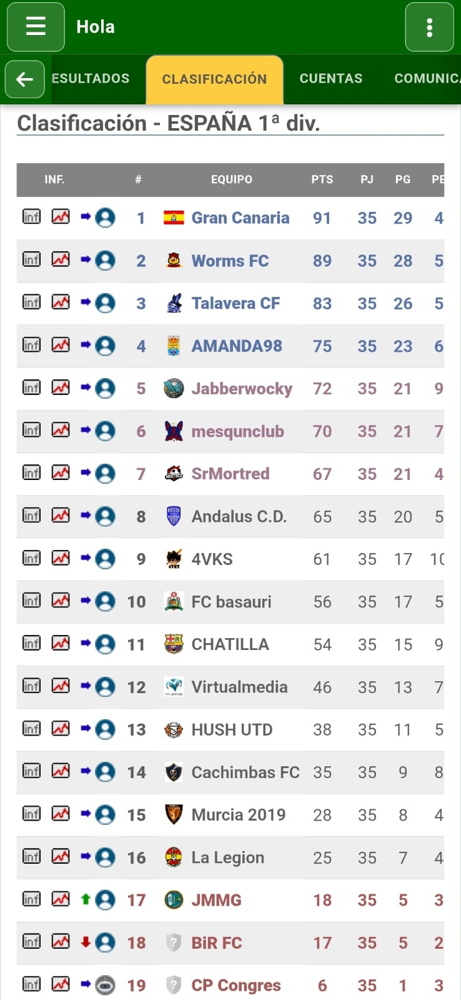<br><sub>Clasificación resumida: puntos y desempates</sub></td>
</tr></table>

### Mercado

En el buscador, las demarcaciones son botones grandes y los filtros van en
secciones que se despliegan; en los resultados, la demarcación y el nombre
quedan fijos al deslizar. En las subastas, el botón de pujar siempre entra
en la pantalla, el nombre y la demarcación quedan fijos al deslizar, los
filtros se pliegan y se eligen con botones, y en un teléfono lento la lista
aparece por tandas en vez de hacerte esperar. En las estadísticas de
traspasos, la edad se elige en un desplegable, sin abrir el menú ⋮.

<table align="center"><tr>
<td align="center" valign="top" width="140">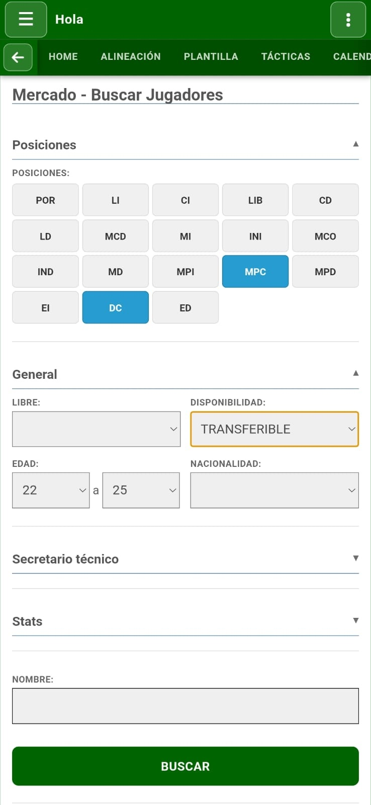<br><sub>Buscador: demarcaciones en botones</sub></td>
<td align="center" valign="top" width="140">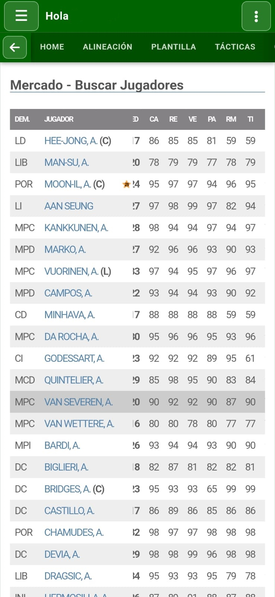<br><sub>Resultados: demarcación y nombre fijos</sub></td>
</tr></table>
<table align="center"><tr>
<td align="center" valign="top" width="140">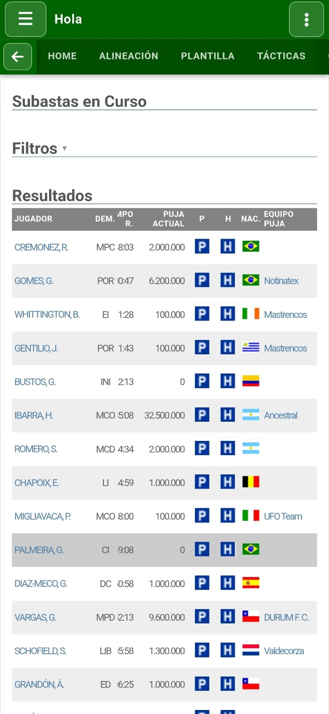<br><sub>Subastas: nombre y demarcación fijos</sub></td>
<td align="center" valign="top" width="140">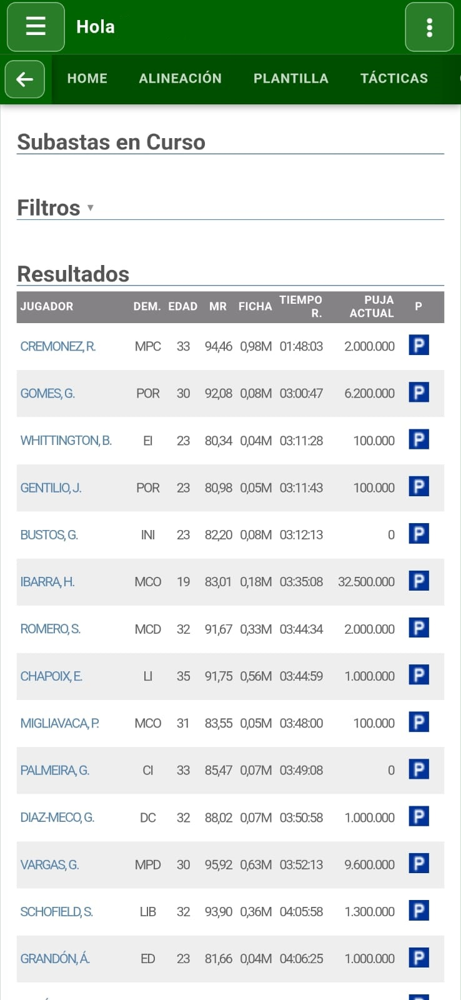<br><sub>Subastas: edad, MR y ficha, con pujar a la vista</sub></td>
</tr></table>
<table align="center"><tr>
<td align="center" valign="top" width="140">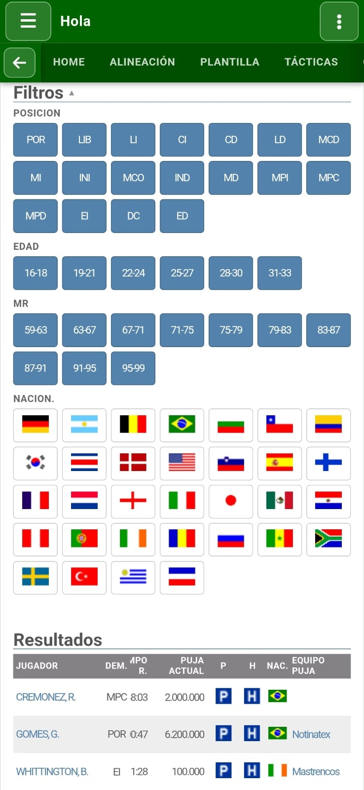<br><sub>Subastas: los filtros, en botones</sub></td>
<td align="center" valign="top" width="140">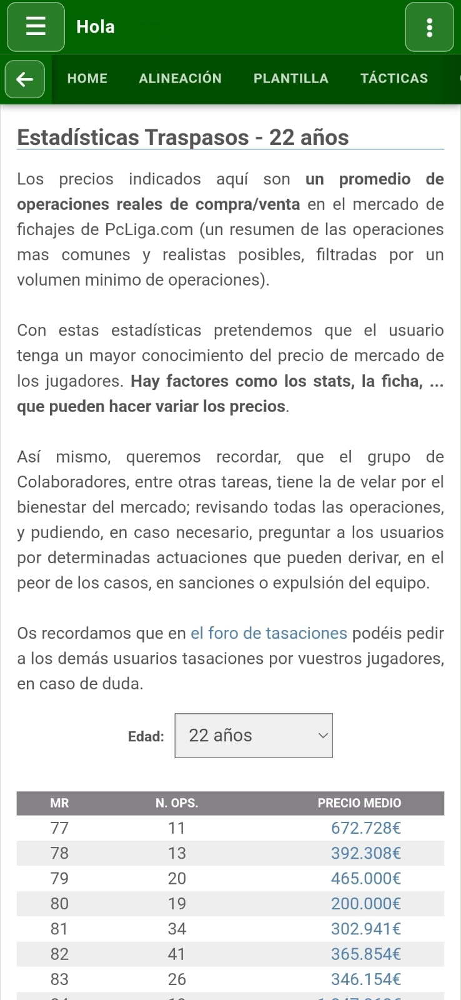<br><sub>Traspasos: la edad, en un desplegable</sub></td>
</tr></table>

### Ficha del jugador

Dos vistas, a elección, y la app recuerda la tuya. La **deslizable**: los
datos y el contrato en una parte, las stats con la media en otra, y se pasa
de una a otra con el dedo. La **completa**: la ficha del juego entera,
achicada para que entre en la pantalla. A la vista clásica de las stats en
barras se suma el **radar**, un gráfico de diez porciones para ver de un
vistazo cómo es el jugador. Y con **Compartir ficha** la mandas como
imagen por WhatsApp o por donde quieras.

<table align="center"><tr>
<td align="center" valign="top" width="140">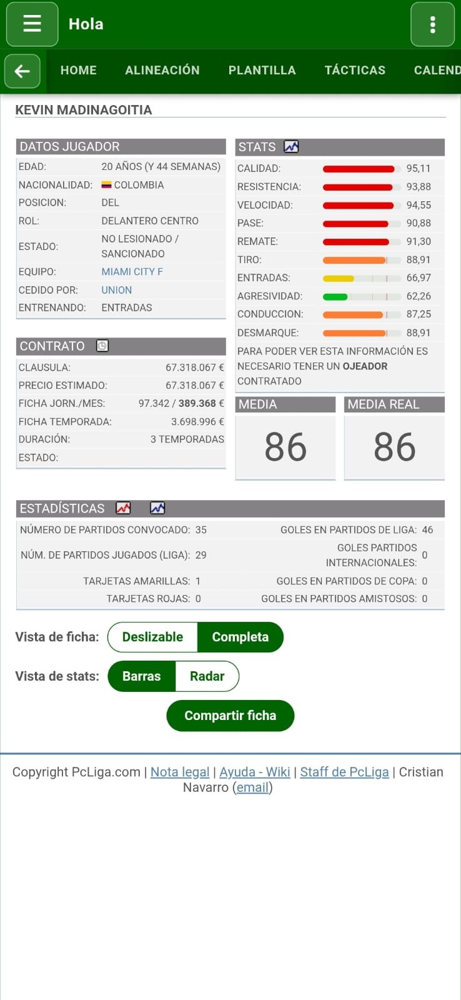<br><sub>Ficha completa: stats en barras</sub></td>
<td align="center" valign="top" width="140">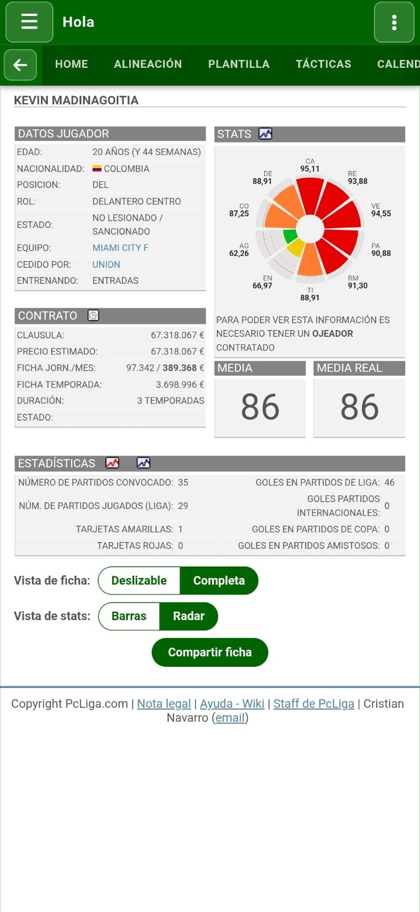<br><sub>Ficha completa: stats en radar</sub></td>
</tr></table>
<table align="center"><tr>
<td align="center" valign="top" width="140">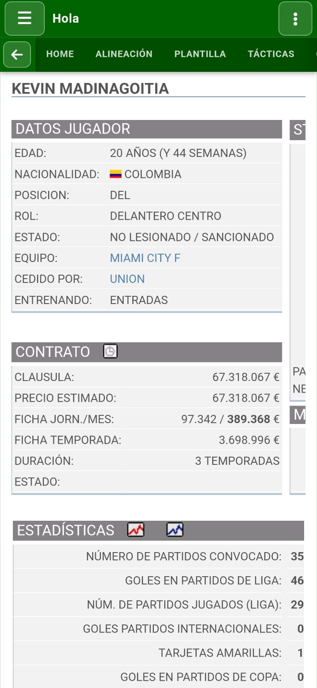<br><sub>Ficha deslizable: datos y contrato</sub></td>
</tr></table>

### Partidos

El visor de partidos se ve igual que en la web, con sus pestañas de
eventos, onces y stats: la app no lo altera.

<table align="center"><tr>
<td align="center" valign="top" width="140">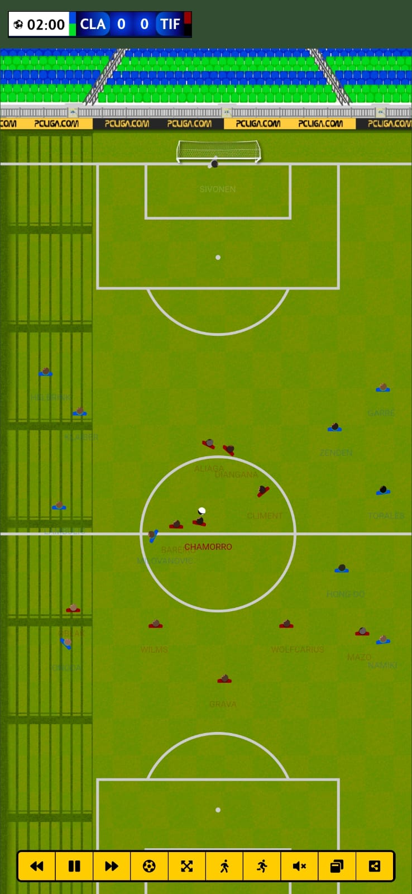<br><sub>Visor de partidos: igual que en la web</sub></td>
<td align="center" valign="top" width="140">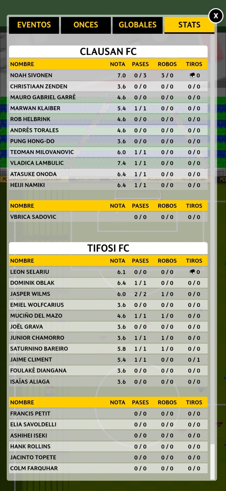<br><sub>Visor de partidos: las stats de cada jugador</sub></td>
</tr></table>

### Tema, colores y zoom

Tema claro, oscuro o el del teléfono; cinco colores para los menús
(verde, el de siempre, azul, granate, petróleo y grafito); y zoom propio,
del 80 % al 130 %, que se recuerda. Todo está en **Configuración (APP)**,
al final del menú ☰, y debajo figura la versión de la app.

<table align="center"><tr>
<td align="center" valign="top" width="140">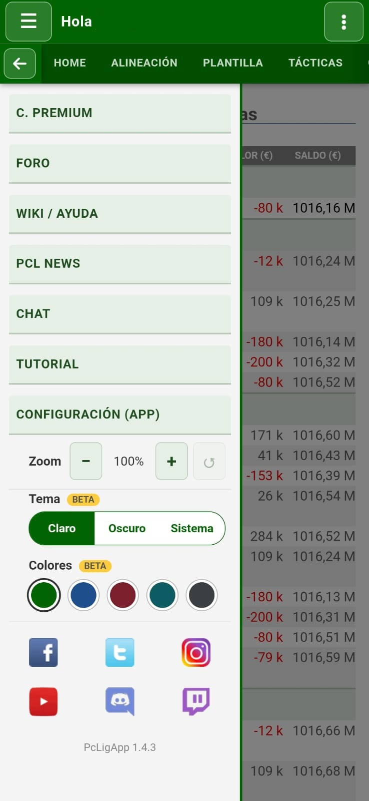<br><sub>Claro, verde</sub></td>
<td align="center" valign="top" width="140">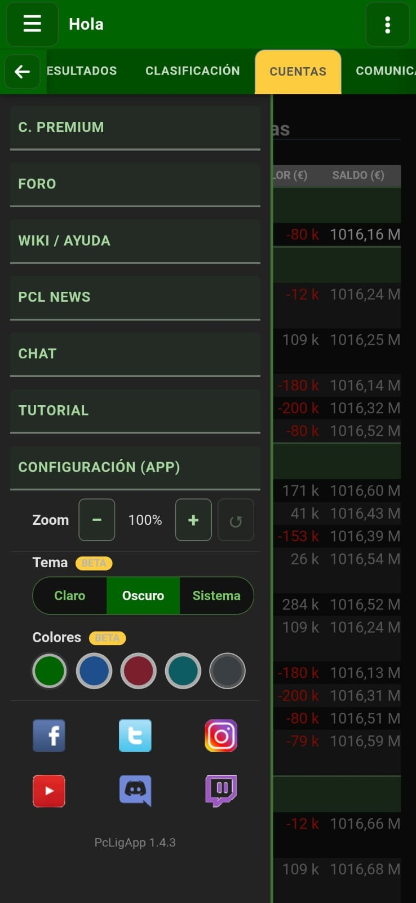<br><sub>Oscuro, verde</sub></td>
</tr></table>
<table align="center"><tr>
<td align="center" valign="top" width="140">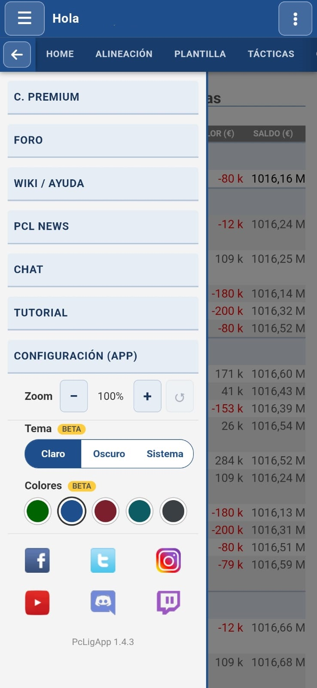<br><sub>Claro, azul</sub></td>
<td align="center" valign="top" width="140">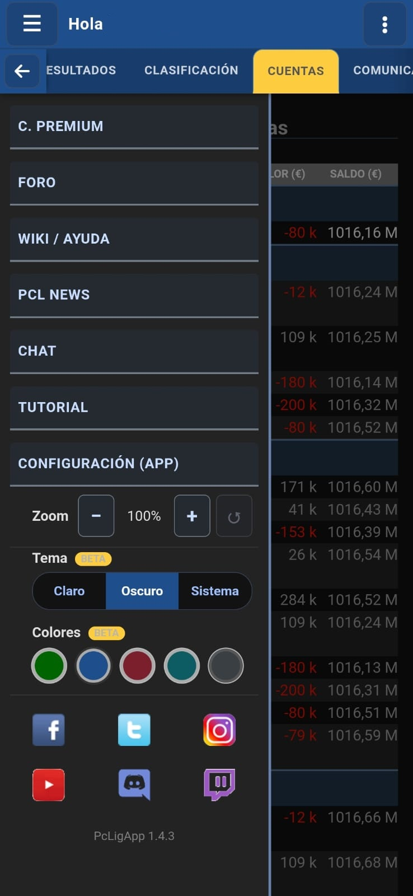<br><sub>Oscuro, azul</sub></td>
</tr></table>
<table align="center"><tr>
<td align="center" valign="top" width="140">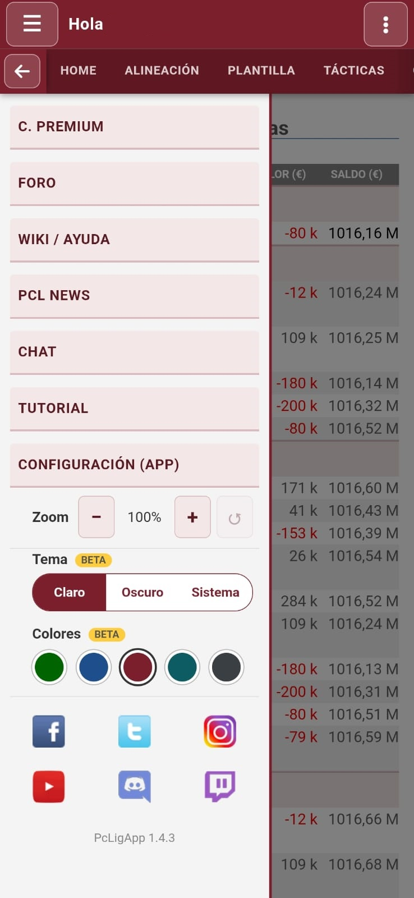<br><sub>Claro, granate</sub></td>
<td align="center" valign="top" width="140">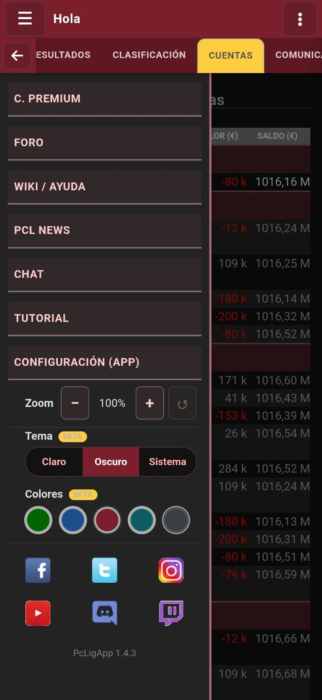<br><sub>Oscuro, granate</sub></td>
</tr></table>
<table align="center"><tr>
<td align="center" valign="top" width="140">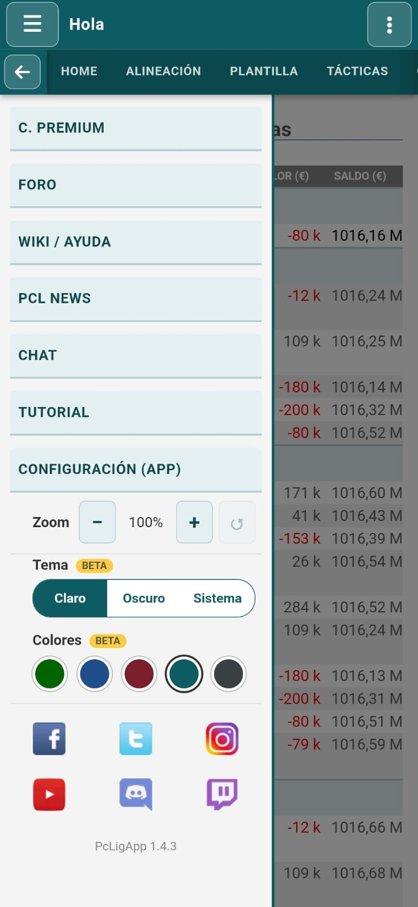<br><sub>Claro, petróleo</sub></td>
<td align="center" valign="top" width="140">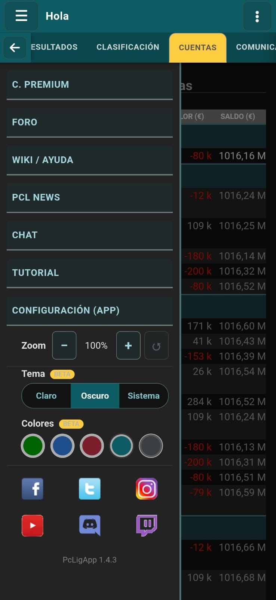<br><sub>Oscuro, petróleo</sub></td>
</tr></table>
<table align="center"><tr>
<td align="center" valign="top" width="140">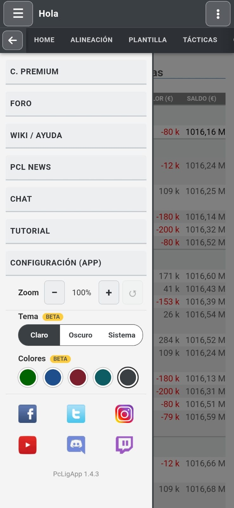<br><sub>Claro, grafito</sub></td>
<td align="center" valign="top" width="140">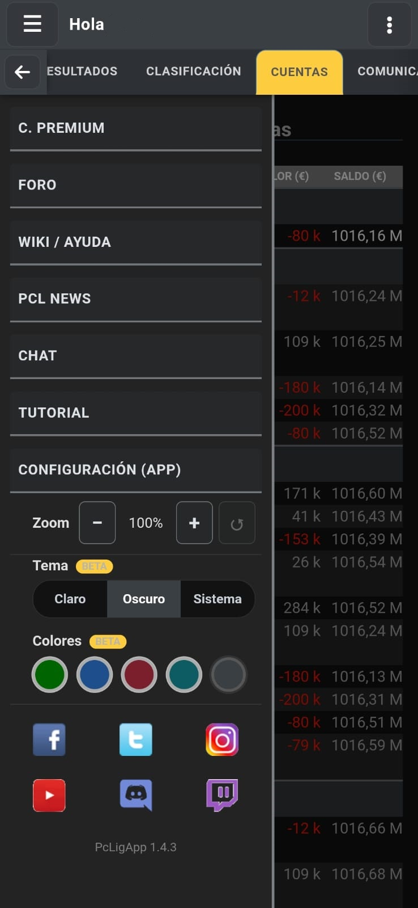<br><sub>Oscuro, grafito</sub></td>
</tr></table>

### Cargas, errores y un tutorial para empezar

Mientras carga una página nueva, queda la anterior con un indicador. Si se
corta internet, aparece un aviso con «Reintentar»; si PcLiga rechaza algo
sin decir por qué, vuelves a la portada con un aviso. La primera vez, un
tutorial recorre el juego (se vuelve a ver desde **Tutorial**, en el menú
☰), y la cuenta nueva se puede crear desde la app.

<table align="center"><tr>
<td align="center" valign="top" width="140">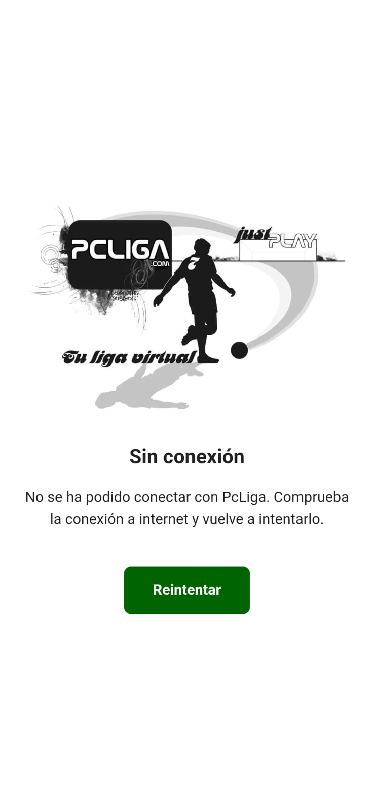<br><sub>Sin conexión: aviso con Reintentar</sub></td>
<td align="center" valign="top" width="140">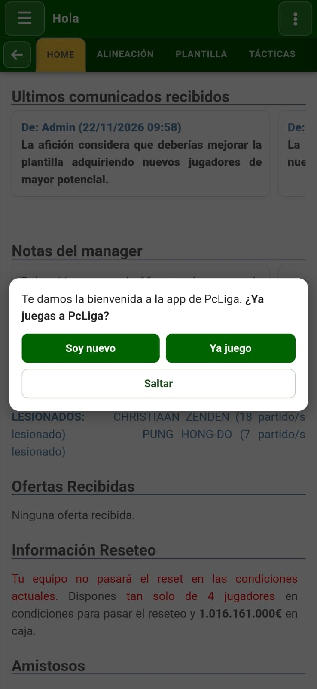<br><sub>Tutorial: la bienvenida, la primera vez</sub></td>
</tr></table>

## Descargar

En **[Releases](../../releases/latest)** está siempre la última versión.
Descarga el archivo `.apk` de la sección *Assets*.

## Instalar

1. Abre el `.apk` descargado en el teléfono.
2. Si Android avisa de que no permite instalar apps de origen desconocido,
   toca **Ajustes** y permite instalar desde esa app (el navegador o el
   gestor de archivos). Después vuelve atrás y toca **Instalar**.
3. Entra con tu usuario y contraseña de PcLiga.

Las versiones nuevas se instalan **encima** de la anterior, sin
desinstalar y sin perder nada.

> Si tienes una beta anterior a la 1.0 (0.5 o anterior), desinstálala
> primero: estaba firmada con otra clave y Android no deja instalar encima.

## Actualizar sola, con Obtainium

[Obtainium](https://github.com/ImranR98/Obtainium) avisa cuando hay una
versión nueva y la instala:

1. Instala Obtainium desde su página.
2. Toca **Añadir app** y pega la dirección de este repositorio.
3. Toca **Añadir**. Desde ahí, Obtainium busca las versiones nuevas.

## Comprobar que el APK es el original

Cada versión trae en sus notas la **huella SHA-256 del archivo**. Todas las
versiones desde la 1.0 están firmadas con el mismo certificado:

```
SHA-256: 26:79:37:A0:D9:BE:E6:94:44:B3:56:13:16:93:30:19:E2:FA:52:9A:B0:17:13:4A:5E:78:E0:DE:22:BE:70:2B
```

Si un APK no coincide, no lo instales.

## Privacidad

- La app **no recoge datos**, no lleva publicidad ni rastreadores y solo
  pide permiso de internet.
- **No guarda tu contraseña.** Si quieres, la recuerda el gestor de
  contraseñas del teléfono (Google, Samsung Pass…).
- Solo se conecta con PcLiga, más tres servidores de Google de los que la
  propia web de PcLiga carga piezas (jQuery y las tipografías) y el captcha
  "No soy un robot". Cualquier otro enlace (foro, wiki, redes) se abre en
  tu navegador.

## Lo que no está en la app

La compra de créditos, los ingresos extra, la cuenta premium con tarjeta o
PayPal y las notificaciones se hacen desde un navegador. Al entrar en esas
páginas, la app explica cómo.

## Dudas y fallos

En el foro o en el Discord de PcLiga.
