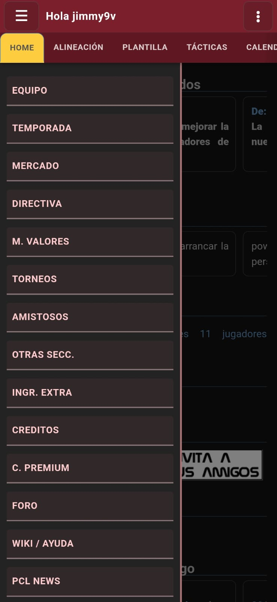
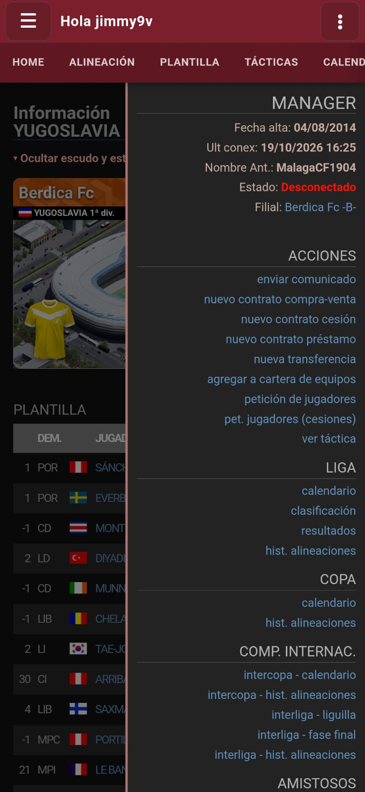
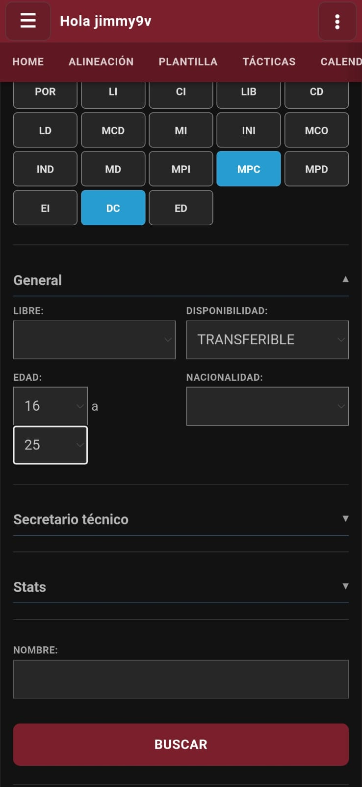

# PcLigApp: PcLiga en el móvil (Android, no oficial)

PcLiga, el manager de fútbol online, adaptado al teléfono. Es la misma
PcLiga de siempre, con tu cuenta y tus datos, pero cada pantalla se acomoda
al móvil: sin pellizcar, ampliar y deslizar para encontrar un dato.

> **App no oficial.** Hecha por un manager para los managers. No tiene
> relación con los responsables de PcLiga.

## Qué cambia respecto de la web

### Menús

La barra de accesos de PcLiga (alineación, plantilla, tácticas,
calendario…) queda fija arriba y se desliza de costado. El menú izquierdo
de la web pasa al botón ☰, con todas las secciones del juego; la columna
derecha, al botón ⋮, con lo que se puede hacer en la página que estás
viendo: en la ficha de otro equipo, por ejemplo, mandarle un comunicado,
ofrecerle un contrato o una transferencia, añadirlo a tu cartera o ver su
táctica.

<p align="center">
  
  
  
</p>

### Alineación, tácticas y clasificación

Las tablas se acomodan al ancho de la pantalla: si no entran, bajan la
letra, acortan los nombres o esconden columnas, lo justo. El ojo de cada
jugador abre su resumen, con las stats con decimales, las medias y, en la
alineación, la EF. La clasificación, cuando no entra, se queda con los
puntos y los criterios de desempate. Y en tácticas, el campo entra entero
en la pantalla. Muchas tablas recuperan la vista completa con solo girar
el teléfono.

<p align="center">
  
  
  
</p>

### Mercado

En el buscador, las demarcaciones son botones grandes y los filtros van en
secciones que se despliegan. En las subastas, el botón de pujar siempre
entra en la pantalla, y en un teléfono lento la lista aparece por tandas
en vez de hacerte esperar.

<p align="center">
  
  
</p>

### Ficha del jugador

Las stats en barras, con los colores de PcLiga, o en un gráfico de diez
porciones; y el histórico de cada temporada, en un gráfico que se ve entero
en el móvil.

<p align="center">
  
  
</p>

### Partidos

En el calendario y los resultados, los goles van separados de los equipos,
con el acceso al visor, a la simulación al minuto y al carrusel de cada
partido.

<p align="center">
  
</p>

### Tema, colores y zoom

Tema claro, oscuro o el del teléfono; cinco colores para los menús; y zoom
propio, del 80 % al 130 %, que se recuerda.

### Cargas y errores

Mientras carga una página nueva, queda la anterior con un indicador. Si se
corta internet, aparece un aviso con "Reintentar"; si PcLiga rechaza algo
sin decir por qué, vuelves a la portada con un aviso.

### Para empezar

Un tutorial recorre el juego la primera vez, y la cuenta nueva se puede
crear desde la app.

## Descargar

En **[Releases](../../releases/latest)** está siempre la última versión.
Descarga el archivo `.apk` de la sección *Assets*.

## Instalar

1. Abre el `.apk` descargado en el teléfono.
2. Si Android avisa de que no permite instalar apps de origen desconocido,
   toca **Ajustes** y permite instalar desde esa app (el navegador o el
   gestor de archivos). Después vuelve atrás y toca **Instalar**.
3. Entra con tu usuario y contraseña de PcLiga.

Las versiones nuevas se instalan **encima** de la anterior, sin
desinstalar y sin perder nada.

> Si tienes una beta anterior a la 1.0 (0.5 o anterior), desinstálala
> primero: estaba firmada con otra clave y Android no deja instalar encima.

## Actualizar sola, con Obtainium

[Obtainium](https://github.com/ImranR98/Obtainium) avisa cuando hay una
versión nueva y la instala:

1. Instala Obtainium desde su página.
2. Toca **Añadir app** y pega la dirección de este repositorio.
3. Toca **Añadir**. Desde ahí, Obtainium busca las versiones nuevas.

## Comprobar que el APK es el original

Cada versión trae en sus notas la **huella SHA-256 del archivo**. Todas las
versiones desde la 1.0 están firmadas con el mismo certificado:

```
SHA-256: 26:79:37:A0:D9:BE:E6:94:44:B3:56:13:16:93:30:19:E2:FA:52:9A:B0:17:13:4A:5E:78:E0:DE:22:BE:70:2B
```

Si un APK no coincide, no lo instales.

## Privacidad

- La app **no recoge datos**, no lleva publicidad ni rastreadores y solo
  pide permiso de internet.
- **No guarda tu contraseña.** Si quieres, la recuerda el gestor de
  contraseñas del teléfono (Google, Samsung Pass…).
- Solo se conecta con PcLiga, más tres servidores de Google de los que la
  propia web de PcLiga carga piezas (jQuery y las tipografías) y el captcha
  "No soy un robot". Cualquier otro enlace (foro, wiki, redes) se abre en
  tu navegador.

## Lo que no está en la app

La compra de créditos, los ingresos extra, la cuenta premium con tarjeta o
PayPal y las notificaciones se hacen desde un navegador. Al entrar en esas
páginas, la app explica cómo.

## Dudas y fallos

En el foro o en el Discord de PcLiga.
